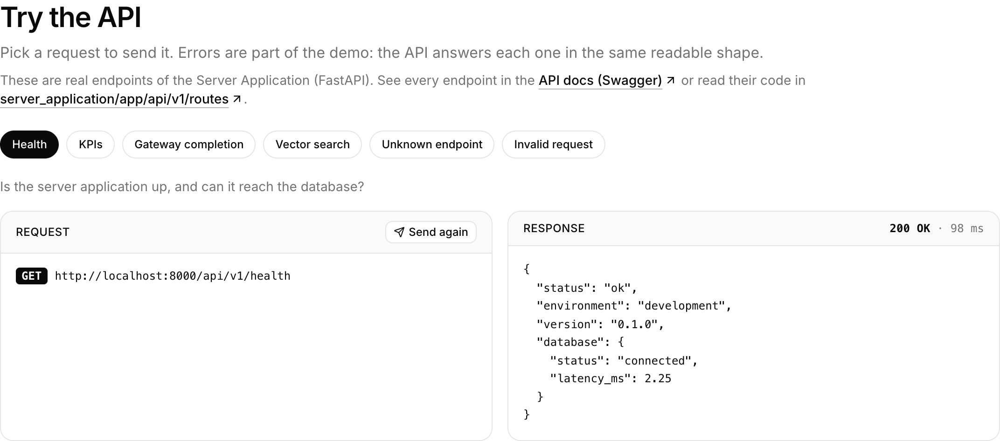

# dev/color Playground


dev/color Playground is a reusable, lightly pre-configured starter kit for applications.

The architecture consists of a **Client Application** built with Next.js, Tailwind CSS, and
shadcn/charts, paired with a **Server Application** powered by FastAPI and PostgreSQL with native
vector search.

Our foundational monorepo aims to accelerate project kickoff, allowing teams to focus on building core features.

**Contents:** [Why Playground](#why-playground) · [Use this template](#use-this-template) ·
[Run it locally](#run-it-locally) · [Server Application](#server-application-back-end) ·
[Client Application](#client-application-front-end) · [Build on it](#build-on-it) ·
[Troubleshooting](#troubleshooting) · [Reference](#reference)

---

## Why Playground

### The Monorepo Advantage

- **Centralized Code, Independent Scaling:** The Client Application and Server Application live in a
  single repository for easy management, but they run, scale, and deploy completely independently.
- **Accelerated Feature Delivery:** Skips infrastructure setup so teams can immediately build platform
  features, learning analytics, or content delivery systems using a modern tech stack.
- **AI-Ready Infrastructure:** The Server Application features native vector search and semantic
  search, with a Python-based FastAPI setup ready to integrate deep learning libraries like PyTorch.
- **Decoupled Performance:** Independent deployment allows the Client Application interface to remain
  highly responsive while the Server Application backend scales separately to process heavy assessment
  data.

### Why Python & FastAPI for AI/ML

- **Native Ecosystem Integration:** The Server Application was built on Python to provide direct,
  seamless access to the vast majority of open-source AI and machine learning libraries.

### Stack at a glance

| Layer | Built with | What it gives you |
|---|---|---|
| **Front End** | TypeScript · Next.js · Tailwind CSS · shadcn/ui Charts | Server-rendered pages, light and dark modes, ready-made charts |
| **Back End** | Python · FastAPI · SQLAlchemy · Alembic · uv | A typed, documented JSON API with versioned database changes |
| **Data Processing** | Polars · Pandas | Fast reading, cleaning and aggregating of large data files |
| **Data Store** | PostgreSQL 18 · pgvector | Relational storage plus similarity search, in one database |
| **Tooling** | mise · bun · Docker | Pinned tool versions and one command for every task |

---

## Use this template

Each institution gets its own copy of Playground, named **`[YourInstitution]_Playground`**. Replace
`YourInstitution` with your institution's short name; for example, UTTC's copy is `UTTC_Playground`.

### 1. Create your copy

**Intention:** Start your project from Playground under your own name, while keeping a link back to
Playground so you can pull in template improvements later.

**Implementation:**

1. **Name your copy.** In a terminal, set these two values (they're used by the commands below):

   ```bash
   INSTITUTION=YourInstitution     # your institution's short name, e.g. UTTC
   GITHUB_ACCOUNT=your-account     # the GitHub user or organization that will own the copy
   ```

2. **Create an empty repository on GitHub** named `[YourInstitution]_Playground`. On GitHub, choose
   **New repository**, enter the name, choose **Private**, and leave **Add a README**, **.gitignore**
   and **license** unchecked. Or, with the GitHub CLI:

   ```bash
   gh repo create "${GITHUB_ACCOUNT}/${INSTITUTION}_Playground" --private
   ```

3. **Clone Playground under your name, and point it at your new repository:**

   ```bash
   git clone git@github.com:kisha/Playground.git "${INSTITUTION}_Playground"
   cd "${INSTITUTION}_Playground"
   git remote rename origin template      # keep a link back to Playground
   git remote add origin "git@github.com:${GITHUB_ACCOUNT}/${INSTITUTION}_Playground.git"
   git push -u origin main
   ```

**Verification:** Your new repository on GitHub shows Playground's files. In the folder, `git remote -v`
lists `origin` as `[YourInstitution]_Playground` and `template` as `Playground`. Later,
`git pull template main` brings in template updates.

### 2. Make it yours

**Intention:** Replace Playground's name and branding, and give the local database its own identity so
several copies can run on one machine.

**Implementation:** Update these values (examples use `YourInstitution`; use your short name):

| What | Where | Example |
|---|---|---|
| Name, logo, footer credit | `client_application/src/content/brand.ts` | `name: "YourInstitution Playground"` |
| Logo image | `client_application/public/brand/` | your logo file |
| Repository link on the landing page | `client_application/.env.local` (copy `.env.example`) | `NEXT_PUBLIC_REPOSITORY_URL=https://github.com/<your-account>/YourInstitution_Playground` |
| API title in the docs | `server_application/.env.development` | `PROJECT_NAME="YourInstitution Playground API"` |
| Docker project name | `docker-compose.yml` (`name:`) | `yourinstitution_playground` |
| Database name and port | `.env` (created by `mise run db`) **and** `DATABASE_URL` in `server_application/.env.development`; for a new port also set `TEST_DATABASE_URL` | `POSTGRES_DB=yourinstitution_dev`, `POSTGRES_PORT=5434` |

**Verification:** After [Run it locally](#run-it-locally), the landing page shows your name and logo,
and `docker compose ls` lists your project name.

---

## Run it locally

**Prerequisites:** Git, [Docker](https://www.docker.com/) or [OrbStack](https://orbstack.dev/) (open and
running), and [mise](https://mise.jdx.dev) (`brew install mise`, or `curl https://mise.run | sh`).
mise installs everything else.

**Quick start** (two terminals, from the repository folder):

```bash
# Terminal 1
mise trust && mise install           # first time only
mise run db                          # PostgreSQL on localhost:5433
mise run api:install && mise run api:dev       # API on http://localhost:8000

# Terminal 2
mise run web:install && mise run web:dev       # Client Application on http://localhost:3000
```

The steps below explain each command and how to check it worked.

### Step 1: Install the toolchain

**Intention:** Get the exact versions of bun, Node, Python and uv this project is built with.

**Implementation:**

```bash
mise trust      # allow this repository's mise.toml (first time only)
mise install
```

**Verification:** `mise ls --current` lists `bun 1.4.3`, `node 24`, `python 3.14` and `uv 0.13`, and
`mise tasks` lists every command.

### Step 2: Start the database

**Intention:** Run PostgreSQL 18 with pgvector in Docker, so you don't need to install a database.

**Implementation:**

```bash
mise run db
```

**Verification:** The command ends with `Container playground-db-1 Healthy`. `mise run db:shell`
opens a SQL prompt (`\q` to exit). Your data persists until you run `mise run db:reset`.

---

## Server Application (Back End)

📁 [`server_application/`](server_application/) · [Full README](server_application/README.md)

A FastAPI API on Python 3.14 that validates requests, reads and writes PostgreSQL, and serves vector
similarity search through pgvector.

### Step 3: Install the Server Application's dependencies

**Intention:** Create the server's Python environment with every library it needs.

**Implementation:**

```bash
mise run api:install
```

**Verification:** uv reports the packages it installed, and `server_application/.venv/` now exists.

### Step 4: Start the Server Application (FastAPI)

**Intention:** Run the API with auto-reload. It applies any pending database migrations first, so a
fresh database gets its tables automatically.

**Implementation:**

```bash
mise run api:dev
```

Leave this terminal open. To skip automatic migrations, run `AUTO_MIGRATE=false mise run api:dev`.

**Verification:** The terminal shows `Server started at http://127.0.0.1:8000`, and
http://localhost:8000/api/v1/health returns `"status": "ok"` with the database `"connected"`:


### Step 5: Explore the endpoints

**Intention:** See every endpoint the API offers, and try any of them from your browser.

**Implementation:** Open the API docs (Swagger UI), which FastAPI generates from the code:
**http://localhost:8000/docs**. The endpoints themselves live in
[`server_application/app/api/v1/routes/`](server_application/app/api/v1/routes/).

**Verification:** You see three groups: **health**, **documents** (pgvector storage and search) and
**sandbox** (mock data for the example charts). Pick any endpoint, then **Try it out** and **Execute**.


### Step 6: Run the Server Application tests

**Intention:** Confirm the API, database and migrations all work together.

**Implementation:**

```bash
mise run api:test
```

**Verification:** `24 passed`. Tests use their own `playground_test` database, so your data is untouched.

---

## Client Application (Front End)

📁 [`client_application/`](client_application/) · [Full README](client_application/README.md)

A Next.js web interface in TypeScript, styled in black and white with light and dark modes, that gets all of
its data from the Server Application.

### Step 7: Install the Client Application's dependencies

**Intention:** Install the Client Application's packages with bun.

**Implementation:** In a **second terminal** (the API keeps running in the first):

```bash
mise run web:install
```

**Verification:** bun reports the packages it installed, and `client_application/node_modules/` exists.

### Step 8: Start the Client Application (Next.js)

**Intention:** Run the Client Application with hot reload and confirm it can reach the Server
Application and the database.

**Implementation:**

```bash
mise run web:dev
```

**Verification:** Open **http://localhost:3000**. The page shows **All systems connected**, and the
**Client Application → Server Application → Data** diagram updates every 5 seconds (see the animation
at the top). If something is down, the page says which part. See [Troubleshooting](#troubleshooting).

### Step 9: Try the API from the Client Application

**Intention:** Watch the Client Application send requests to the Server Application and show exactly
what comes back, including how errors look.

**Implementation:** Click **See example charts** on the landing page (or **Sandbox** in the header),
or open **http://localhost:3000/sandbox#api**. Pick a request: Health, KPIs, a chart's data, vector
search, an unknown endpoint or an invalid request. These are the same endpoints listed in the
[API docs (Swagger)](http://localhost:8000/docs), defined in
[`server_application/app/api/v1/routes/`](server_application/app/api/v1/routes/).

**Verification:** The response panel shows the status and timing (for example `200 OK · 12 ms`) and the
JSON body. The unknown endpoint returns `404` and the invalid request returns `422`, both in the same
readable error shape.



### Step 10: Example Implementation of Charts

**Intention:** See dashboard-style charts drawn from API responses, modeled on PDP Analysis-Ready (AR)
data. Use them as starting points for your own dashboards.

**Implementation:** Scroll to **Example charts** on http://localhost:3000/sandbox. Each chart loads its
own `/api/v1/sandbox/...` endpoint. All data is mock data.

Every chart endpoint answers in the same shape: **`meta`** (title, description, the one-sentence
answer as `takeaway`, the AR `fields_used`, filters and definitions) and **`rows`** (one per point or
bar). For example, the **Gateway course completion** chart draws this response, which you can send
yourself under **Try the API → Gateway completion**:


`meta.title` becomes the chart's title, `meta.takeaway` its **Answer**, and each row in `rows` one
point per line (`english` solid, `math` dashed). See
[Sandbox in the Server Application README](server_application/README.md#sandbox) for every endpoint.

**Verification:** Eight KPI cards and seven charts load, each with an **Answer** and the **Fields used**:


### Step 11: Check the Client Application code

**Intention:** Confirm the Client Application passes linting, type checking and a production build.

**Implementation:**

```bash
mise run web:lint
mise run web:build
```

**Verification:** No errors, and the build lists the routes `/`, `/sandbox` and `/_not-found`.

### When you're done

Press `Ctrl+C` in each terminal to stop the Server Application and the Client Application, then
`mise run db:down` to stop the database. Your data is kept for next time.

---

## Build on it

Where your own code goes. Each folder has one job, so changes stay small and easy to review.

**Add an API endpoint** in `server_application/app/`:

| Step | File | What goes there |
|---|---|---|
| 1 | `schemas/<topic>.py` | Request and response shapes (Pydantic) |
| 2 | `models/<topic>.py`, then `mise run api:migration "add <topic>"` | Only if it stores data. Import the model in `models/__init__.py`. |
| 3 | `services/<topic>.py` | The logic and database queries |
| 4 | `api/v1/routes/<topic>.py` | A thin route that calls the service. Use `SessionDep` from `api/dependencies.py`. |
| 5 | `api/v1/router.py` | Include the new router |
| 6 | `tests/test_<topic>.py` | Tests, run with `mise run api:test` |

**Show it in the Client Application** in `client_application/src/`:

| Step | File | What goes there |
|---|---|---|
| 1 | `services/<topic>.ts` | Types that mirror the schema, and a function that calls `apiRequest` |
| 2 | `lib/` and `content/` | Formatting, mapping, labels and settings: anything that isn't markup |
| 3 | `hooks/` | Browser state, e.g. `useApiResource(load)` for loading / success / error |
| 4 | `components/<area>/` | Components that only render |
| 5 | `app/<route>/page.tsx` | The page, built from components |

**Rule of thumb:** `.tsx` files render; logic lives in `.ts` files. Check with `mise run web:lint`.

---

## Troubleshooting

| You see | Cause | Fix |
|---|---|---|
| **Server application unreachable** on the landing page | The API isn't running | `mise run api:dev` |
| **Server application up, database unreachable** | The database is stopped | `mise run db` |
| `port is already allocated` / `address already in use` | Something else uses 5433, 8000 or 3000 | Stop it, or change `POSTGRES_PORT` in `.env` and the port in `DATABASE_URL` |
| `Cannot connect to the Docker daemon` | Docker or OrbStack isn't open | Open it, then `mise run db` |
| `/documents` returns `500` after pulling changes | Migrations not applied | `mise run api:migrate` |
| Styles look stale after pulling changes | The dev server cached old CSS | Restart `mise run web:dev` |
| `mise` asks to trust the config | First run in this folder | `mise trust` |

This is what **Server application unreachable** looks like. Start the API and it turns solid again within 5 seconds:


---

## Reference

### Environments

Both applications know which environment they run in: `APP_ENV` on the server and
`NEXT_PUBLIC_APP_ENV` on the client, with `development` (default), `staging` and `production`
(placeholders). Production hides the API docs and the sandbox.

- **Server:** `server_application/.env.<environment>` holds non-secret defaults; secrets go in
  git-ignored `.env.<environment>.local` files or the host's environment variables.
- **Client:** defaults live in `client_application/src/lib/env.ts`; override them in a git-ignored
  `.env.local`. Client values ship to the browser, so they are never secret.

### Commands

Run from the repository folder. `mise tasks` lists them all.

| Database | Server Application | Client Application |
|---|---|---|
| `mise run db`: start | `mise run api:install`: install | `mise run web:install`: install |
| `mise run db:down`: stop (keeps data) | `mise run api:dev`: run + migrate | `mise run web:dev`: run |
| `mise run db:shell`: SQL prompt | `mise run api:test`: tests | `mise run web:lint`: lint + types |
| `mise run db:logs`: logs | `mise run api:migrate` / `api:migrate-down` | `mise run web:build`: production build |
| `mise run db:reset`: wipe and restart | `mise run api:migration "message"`: new migration | `mise run web:build-staging`: staging build |
| | `mise run api:lint` / `api:format` | `mise run web:start`: serve the build |

### Repository layout

```
Playground/
├── client_application/   # Front End: Next.js (see its README)
├── server_application/   # Back End: FastAPI (see its README)
├── docker-compose.yml    # Local PostgreSQL 18 + pgvector
└── mise.toml             # Tool versions + every command
```

### Core languages and libraries

Items marked *available* are installed but not yet used by a feature. Items marked *needs setup*
(jose, PyJWT, bcrypt) also need configuration first: authentication (signing keys, a users table,
login) is intentionally not built.

<details>
<summary><strong>Front End: TypeScript</strong></summary>

- [Next.js](https://nextjs.org/): React framework used to build fast, server-rendered web applications, with request-level route protection through its proxy (formerly middleware) and client state management.
- [Tailwind CSS](https://tailwindcss.com/): Utility-first CSS framework used to build modern, responsive, dark-mode user interfaces with high design consistency.
- [shadcn/ui Charts](https://ui.shadcn.com/charts): Customizable React chart components built on Recharts and styled with Tailwind CSS variables for donut rings, line trends and bar graphs.
- [Recharts](https://recharts.org/): The SVG charting engine driving shadcn/ui Charts.
- [next-themes](https://github.com/pacocoursey/next-themes): Light and dark mode that follows the operating system until the user chooses, with no flash on load.
- [pele](https://pele.run): *Available.* A small, dependency-free renderer that turns Mermaid diagram text into SVG, themed with CSS variables so diagrams follow light and dark mode.
- [jose](https://github.com/panva/jose): *Available, needs setup:* verifies login tokens in the Next.js proxy before protected pages load; needs the API's signing key (or public key) and a `proxy.ts`.

</details>

<details>
<summary><strong>Back End: Python</strong></summary>

- [FastAPI](https://fastapi.tiangolo.com/): High-performance Python web framework used for API routing, background PDP file upload processing and query translation.
- [uv](https://github.com/astral-sh/uv): Extremely fast Python package installer and dependency resolver, written in Rust.
- [SQLAlchemy 2.x](https://www.sqlalchemy.org/): Typed, async ORM used to define database models and run queries.
- [Alembic](https://alembic.sqlalchemy.org/): Records every schema change as a versioned migration, so every environment's database can be upgraded or rolled back the same way.
- [Pydantic](https://docs.pydantic.dev/): Validates incoming request data and serializes responses to JSON; FastAPI is built on it.
- [PyJWT](https://pyjwt.readthedocs.io/): *Available, needs setup:* issues and verifies signed JWT tokens containing user roles; needs a signing key in settings and login endpoints.
- [bcrypt](https://github.com/pyca/bcrypt): *Available, needs setup:* hashes passwords with a deliberately slow, salted algorithm; needs a users table and sign-up/login endpoints.

</details>

<details>
<summary><strong>Data Processing</strong></summary>

- [Pandas](https://pandas.pydata.org/) / [Polars](https://pola.rs/): *Available.* High-speed Python data processing libraries used to parse, clean and aggregate multi-column PDP AR files in seconds. Polars does the heavy lifting; Pandas covers libraries that expect it; [pyarrow](https://arrow.apache.org/docs/python/) converts between them.

</details>

<details>
<summary><strong>Data Store</strong></summary>

- [PostgreSQL 18](https://www.postgresql.org/): Enterprise-grade open-source relational database used for secure storage of student records in standard tables and binary JSONB fields.
- [pgvector](https://github.com/pgvector/pgvector): Postgres extension that stores embeddings as vector columns and finds the most similar rows with fast, indexed similarity search.

</details>

<details>
<summary><strong>Tooling</strong></summary>

- [mise](https://mise.jdx.dev): Pins the exact bun, Node, Python and uv versions and runs every day-to-day command.
- [bun](https://bun.sh): Fast JavaScript runtime and package manager used to install and run the Client Application.
- [Docker](https://www.docker.com/): Runs PostgreSQL locally without installing it.

</details>

---

Made with ♥ by dev/color.
