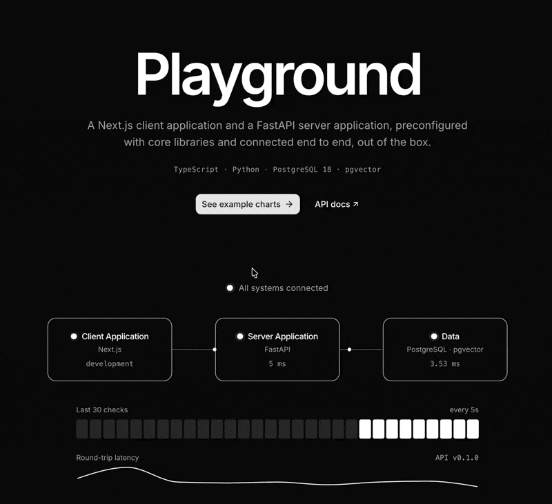
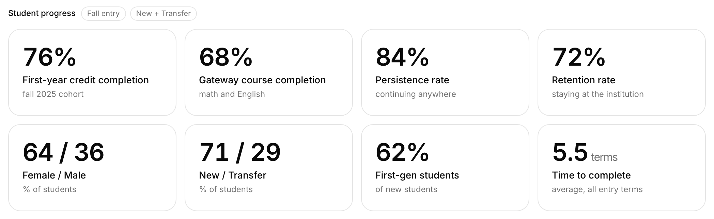
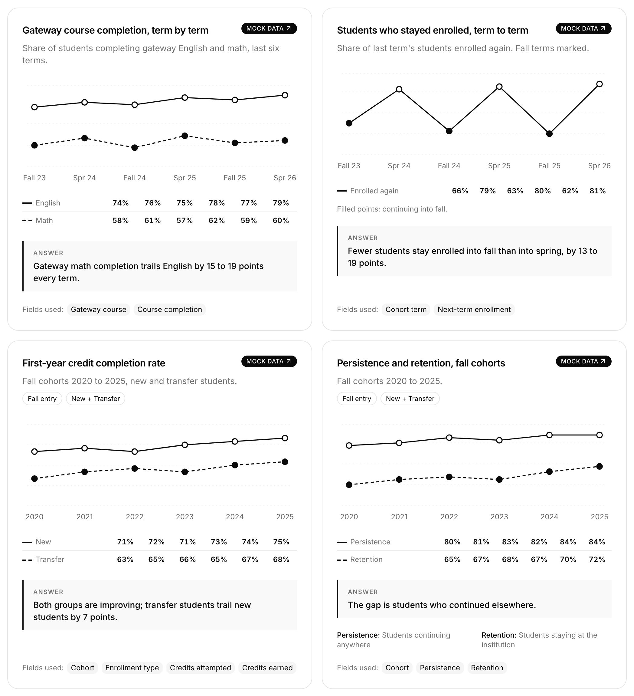
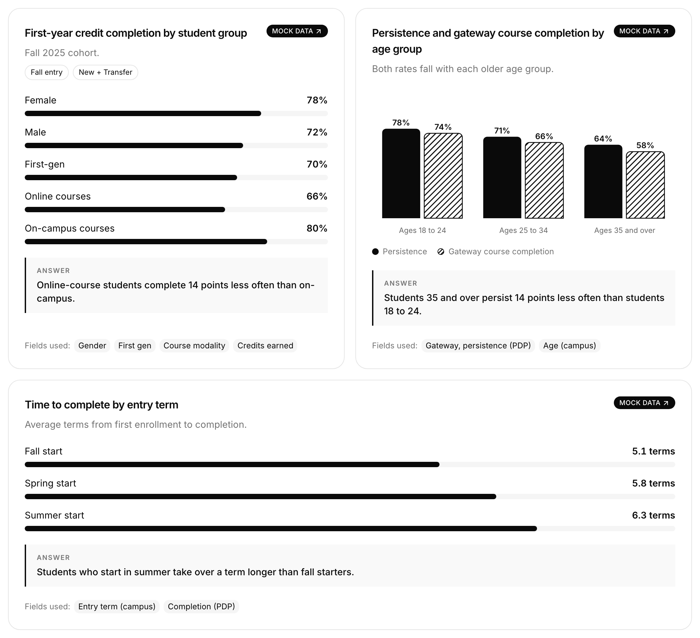

# dev/color Playground

dev/color Playground is a ready-to-use starter kit, so engineering crews skip foundational setup
and start building features. It pairs a Next.js **Client Application** with a FastAPI + PostgreSQL **Server Application**.

**Contents:** [Start here](#start-here) · [Why Playground](#why-playground) · [Tech Stack](#tech-stack-summary) ·
[How to set up your institution's Playground](#how-to-set-up-your-institutions-playground) · [How to run it locally](#how-to-run-it-locally) ·
[Commands](#commands) · [Troubleshooting](#troubleshooting) · [Reference](#reference)

---

## Start here

Are you contributing to Playground, or creating one for your organization?

- **Contributing to Playground:** Clone it and run it as is. Do not rename anything: keep the Playground
  names, database and ports. Go to [How to run it locally](#how-to-run-it-locally).
- **Creating a Playground for your organization or institution:** You must rename it. Follow
  [How to set up your institution's Playground](#how-to-set-up-your-institutions-playground) first, then
  [How to run it locally](#how-to-run-it-locally).

## Why Playground

- **One starter kit, independent applications:** The Client and Server Applications live together in one
  repository but run, scale and deploy separately.
- **Features, not foundational setup:** The foundation is covered, so crews focus on building features.

## Tech Stack Summary

| Layer | Language(s) | Framework | What it gives |
|---|---|---|---|
| **Front End** | TypeScript | Next.js · Tailwind CSS · shadcn/ui Charts | Server-rendered pages, light/dark mode, charts |
| **Back End** | Python | FastAPI · SQLAlchemy 2.1.5 · Alembic · uv | Typed JSON API with versioned migrations |
| **Data Processing** | Python | Polars · Pandas | Fast cleaning and aggregating of large files |
| **Data Store** | SQL | PostgreSQL 18 · pgvector (SQLite optional) | Relational data plus similarity search |
| **Tooling** | — | mise · bun · Docker | Pinned versions, one command per task |

### Core languages and libraries

Click a layer to see the libraries.

📦 *Available* = installed, not yet used.\
🔐 *Needs setup* = authentication pieces, intentionally not built.

<details open>
<summary><strong>Front End: TypeScript</strong></summary>

- [Next.js](https://nextjs.org/): Server-rendered React framework with route protection via its proxy.
- [Tailwind CSS](https://tailwindcss.com/): Utility-first styling with dark mode.
- [shadcn/ui Charts](https://ui.shadcn.com/charts): Donut, line and bar chart components.
- [Recharts](https://recharts.org/): SVG engine behind shadcn/ui Charts.
- [next-themes](https://github.com/pacocoursey/next-themes): Light/dark mode that follows the OS, no flash on load.
- [pele](https://pele.run): 📦 Renders Mermaid diagrams as themed SVG.
- [jose](https://github.com/panva/jose): 📦 🔐 Verifies login tokens in the proxy.

</details>

<details>
<summary><strong>Back End: Python</strong></summary>

- [FastAPI](https://fastapi.tiangolo.com/): Fast Python API framework.
- [uv](https://github.com/astral-sh/uv): Fast package installer, written in Rust.
- [SQLAlchemy 2.1.5](https://www.sqlalchemy.org/): Typed, async ORM for models and queries.
- [Alembic](https://alembic.sqlalchemy.org/): Versioned database migrations, upgrade or roll back.
- [Pydantic](https://docs.pydantic.dev/): Validates requests and serializes responses.
- [PyJWT](https://pyjwt.readthedocs.io/): 📦 🔐 Issues and verifies JWT tokens.
- [bcrypt](https://github.com/pyca/bcrypt): 📦 🔐 Salted password hashing.

</details>

<details>
<summary><strong>Data Processing</strong></summary>

- [Polars](https://pola.rs/) / [Pandas](https://pandas.pydata.org/): 📦 Parse, clean and aggregate PDP AR files; Polars does the heavy lifting, [pyarrow](https://arrow.apache.org/docs/python/) converts between them.

</details>

<details>
<summary><strong>Data Store</strong></summary>

- [PostgreSQL 18](https://www.postgresql.org/): Relational database with JSONB support. The default.
- [SQLite](https://sqlite.org/): Optional instead of PostgreSQL, for an instance that wants no Docker
  ([choose it](#setup-2-choose-your-database)).
- [pgvector](https://github.com/pgvector/pgvector): Stores embeddings and finds similar rows fast.

</details>

<details>
<summary><strong>Tooling</strong></summary>

- [mise](https://mise.jdx.dev): Installs and pins versions of almost any language or tool (e.g., Node,
  Python, Rust, Ruby, Go, Java and more). Here it pins bun, Node, Python and uv, and runs every command
  (see 👉🏾 [Commands](#commands)).
- [bun](https://bun.sh): JavaScript runtime and package manager.
- [Docker](https://www.docker.com/): Runs PostgreSQL locally.

</details>

---

## How to set up your institution's Playground

> **Only for a new organization or institution.** Contributing to Playground? Don't rename anything; go to
> [How to run it locally](#how-to-run-it-locally).

Each institution creates its own copy of this starter kit, named **`[YourInstitution]_Playground`** (for
example, `UTTC_Playground`).

### Setup 1: Create a Playground for your institution

Create an empty **private** repository on GitHub (no README, .gitignore or license), then clone
Playground into it.

**a. Set your two names**

```bash
# Your institution's short name, e.g. UTTC
INSTITUTION=YourInstitution

# The GitHub user or organization that will own the copy
GITHUB_ACCOUNT=your-account
```

**b. Create the repository and clone Playground**

```bash
# Or create it on github.com
gh repo create "${GITHUB_ACCOUNT}/${INSTITUTION}_Playground" --private

git clone git@github.com:kisha/Playground.git "${INSTITUTION}_Playground"
cd "${INSTITUTION}_Playground"
```

**c. Point it at your new repository**

```bash
# Keep a link back to Playground
git remote rename origin playground

git remote add origin "git@github.com:${GITHUB_ACCOUNT}/${INSTITUTION}_Playground.git"
git push -u origin main
```

Your repository now has Playground's files. Later, to bring in Playground updates:

```bash
git pull playground main
```

### Setup 2: Choose your database

Choose once, now, before anything uses the database. Everyone on your instance then uses the same one.

| | PostgreSQL (default) | SQLite |
|---|---|---|
| Needs | Docker or OrbStack | Nothing |
| Vector search | Indexed, with pgvector | Works, without an index |
| Choose it for | Most instances; it matches Playground | A small instance without Docker |

Install the toolchain (`mise trust && mise install`), then run one of:

```bash
mise run db:choose postgresql   # the default
mise run db:choose sqlite
```

It sets `DATABASE_URL` in `server_application/.env.development`. Commit that file. From then on `mise run db`,
`mise run api:dev` and `mise run api:test` use your choice. Contributors to Playground skip this step.

### Setup 3: Make it yours

Swap in your institution's name. Examples use `YourInstitution`.

**a. Brand the Client Application**

Put your logo in `client_application/public/brand/`, then set the name:

```ts
// client_application/src/content/brand.ts  (name, logo, footer credit)
name: "YourInstitution Playground"
```

Link the landing page to your repository (copy `client_application/.env.example` to `.env.local` first):

```bash
# client_application/.env.local
NEXT_PUBLIC_REPOSITORY_URL=https://github.com/<your-account>/YourInstitution_Playground
```

**b. Name the Server Application**

```bash
# server_application/.env.development
PROJECT_NAME="YourInstitution Playground API"
```

**c. Name the database**

```bash
# .env
POSTGRES_DB=yourinstitution_dev
POSTGRES_PORT=5434
```

PostgreSQL only: also name the Docker project.

```yaml
# docker-compose.yml
name: yourinstitution_playground
```

Then run your choice from Setup 2 again, which applies the new name (and port) to `DATABASE_URL`:

```bash
mise run db:choose postgresql   # or sqlite
```

---

## How to run it locally

**Prerequisites:** Git, [Docker](https://www.docker.com/) or [OrbStack](https://orbstack.dev/) (open and
running; not needed with SQLite), [mise](https://mise.jdx.dev) and [bun](https://bun.sh). mise installs everything else.

```bash
brew install mise
brew install oven-sh/bun/bun
```

**Get the code:** Contributors clone Playground itself. Setting up an instance? You already cloned yours in
[Setup 1](#setup-1-create-a-playground-for-your-institution).

```bash
git clone git@github.com:kisha/Playground.git
cd Playground
```

### Step 1: Install the toolchain

Install the pinned versions of bun, Node, Python and uv.

```bash
mise trust && mise install
```

### Step 2: Start the database

Run PostgreSQL 18 with pgvector in Docker; it ends with `Healthy`. An instance that chose SQLite has nothing to
start, and this says so.

```bash
mise run db
```

---

## Server Application (Back End)

A FastAPI API on Python 3.14 that reads and writes PostgreSQL and serves vector search.
📁 [`server_application/`](server_application/) · [README](server_application/README.md)

### Step 3: Start the Server Application (FastAPI)

Installs dependencies, applies any pending migrations, then starts with auto-reload.

```bash
mise run api:install && mise run api:dev
```

Check it: http://localhost:8000/api/v1/health


### Step 4: Explore the endpoints

Every endpoint, ready to try in the browser: http://localhost:8000/docs ·
[code](server_application/app/api/v1/routes/)


### Step 5: Run the tests

All tests should pass. They use their own `playground_test` database.

```bash
mise run api:test
```

---

## Client Application (Front End)

A Next.js web interface in TypeScript, black and white with light and dark modes, that gets all of
its data from the Server Application.
📁 [`client_application/`](client_application/) · [README](client_application/README.md)

### Step 6: Start the Client Application (Next.js)

In a second terminal (the Server Application keeps running in the first):

```bash
mise run web:install && mise run web:dev
```

Open http://localhost:3000. It should say **All systems connected**:


### Step 7: Explore the sandbox

The **sandbox** endpoint series is where you create and test new features and preview how charts and
graphs look in your development environment. All data is mock data, and the sandbox is turned off in
production.

In the sandbox (http://localhost:3000/sandbox) you can:

- **Try the API:** Send real requests to the Server Application and see the responses
  ([`/sandbox#api`](http://localhost:3000/sandbox#api)).
- **Preview charts:** Each chart loads its own `/api/v1/sandbox/...` endpoint.
- ✨ **Add your own:** New sandbox pages can show how other charts, trends and features could work.

#### Add a sandbox page

A sandbox page has two halves: endpoints on the back end and a page that draws them. Worked example:
[`/sandbox/enrollment`](http://localhost:3000/sandbox/enrollment). Copy one folder on each side.

1. **Add the endpoints (FastAPI):** Copy `server_application/app/sandbox/enrollment/`
   ([steps](server_application/README.md#add-a-sandbox-endpoint)).
2. **Add the page (Next.js):** Copy `client_application/src/app/sandbox/enrollment/`
   ([steps](client_application/README.md#add-a-sandbox-page)).


<details open>
<summary>📊 <strong>See the example charts</strong> (KPI cards, trend lines and bar charts)</summary>

**KPI cards:** `/sandbox/kpis`



**Trend lines:** `/sandbox/gateway-completion` · `/sandbox/term-enrollment` ·
`/sandbox/credit-completion` · `/sandbox/persistence-retention`



**Bar charts:** `/sandbox/completion-by-group` · `/sandbox/persistence-by-age` ·
`/sandbox/time-to-complete`



</details>

### When you're done

Press `Ctrl+C` in each terminal, then stop the database (your data is kept):

```bash
mise run db:down
```

---

## Commands

Run from the repository folder. To print this list:

```bash
mise tasks
```

<details>
<summary><strong>Database</strong></summary>

| Command | What it does |
|---|---|
| `mise run setup` | Create the local `.env` from `.env.example` (safe to re-run; `db` runs it for you) |
| `mise run db:choose postgresql\|sqlite` | Choose the database, once, when setting up an instance (PostgreSQL is the default) |
| `mise run db` | Start PostgreSQL 18 + pgvector and wait until it is healthy (nothing to start with SQLite) |
| `mise run db:down` | Stop PostgreSQL (data is kept) |
| `mise run db:logs` | Follow the PostgreSQL logs |
| `mise run db:shell` | Open a SQL prompt (`\q` to exit) |
| `mise run db:reset` | Delete all data and start a fresh database |

</details>

<details>
<summary><strong>Server Application</strong></summary>

| Command | What it does |
|---|---|
| `mise run api:install` | Install dependencies with uv |
| `mise run api:dev` | Apply pending migrations, then run on http://localhost:8000 with auto-reload |
| `AUTO_MIGRATE=false mise run api:dev` | Same, but skip the migrations |
| `mise run api:test` | Run the tests |
| `mise run api:test-sqlite` | Run the tests on SQLite, whichever database is chosen |
| `mise run api:lint` | Check linting and formatting |
| `mise run api:format` | Fix lint issues and format the code |
| `mise run api:migrate` | Apply all pending migrations |
| `mise run api:migrate-down` | Roll back the most recent migration |
| `mise run api:migration "message"` | Create a migration from model changes |

</details>

<details>
<summary><strong>Client Application</strong></summary>

| Command | What it does |
|---|---|
| `mise run web:install` | Install dependencies with bun |
| `mise run web:dev` | Run on http://localhost:3000 with hot reload |
| `mise run web:lint` | Lint and type-check |
| `mise run web:build` | Production build |
| `mise run web:build-staging` | Staging build |
| `mise run web:start` | Serve the last build on http://localhost:3000 |

</details>

---

## Troubleshooting

| You see | Cause | Fix |
|---|---|---|
| **Server application unreachable** on the landing page | The API isn't running | `mise run api:dev` |
| **Server application up, database unreachable** | The database is stopped | `mise run db` |
| `port is already allocated` / `address already in use` | Something else uses 5433, 8000 or 3000 | Stop it, or change `POSTGRES_PORT` in `.env` and the port in `DATABASE_URL` |
| `Cannot connect to the Docker daemon` | Docker or OrbStack isn't open | Open it, then `mise run db` |
| `500` errors after pulling changes | Migrations not applied | `mise run api:migrate` |

**Server application unreachable** looks like this; start the API and it recovers within 5 seconds:


---

## Reference

### Environment Configuration

Both applications know which environment they're in (`development`, `staging` or `production`) from
`APP_ENV` (server) and `NEXT_PUBLIC_APP_ENV` (client). Production turns off the API docs and the sandbox.

**Server Application**

- **Defaults:** Public, non-secret values go in `server_application/.env.<environment>`.
- **Secrets:** Go in git-ignored `.env.<environment>.local` files or host environment variables.

**Client Application**

- **Defaults:** Live in `client_application/src/lib/env.ts`.
- **Overrides:** Go in a git-ignored `.env.local` file.
- **No secrets:** Every client value is visible in the browser.

### Repository layout

```
Playground/
├── client_application/   # Front End: Next.js (see its README)
├── server_application/   # Back End: FastAPI (see its README)
├── docker-compose.yml    # Local PostgreSQL 18 + pgvector
└── mise.toml             # Tool versions + every command
```

---

Made with ♥ by dev/color.
