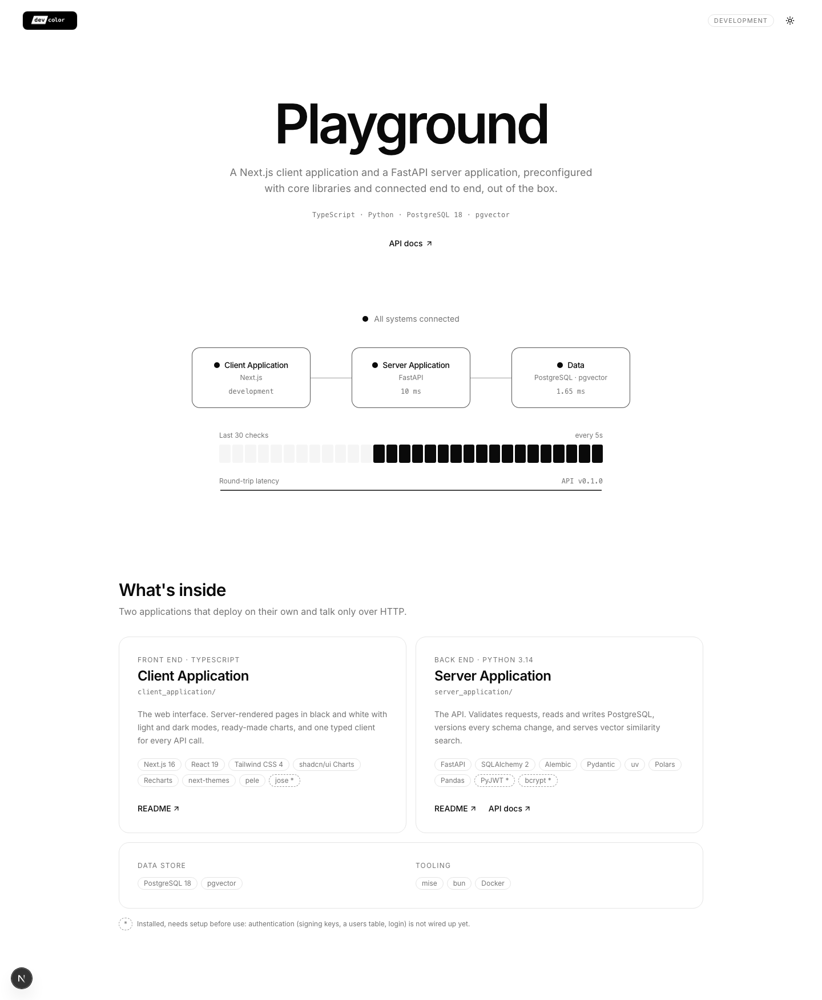
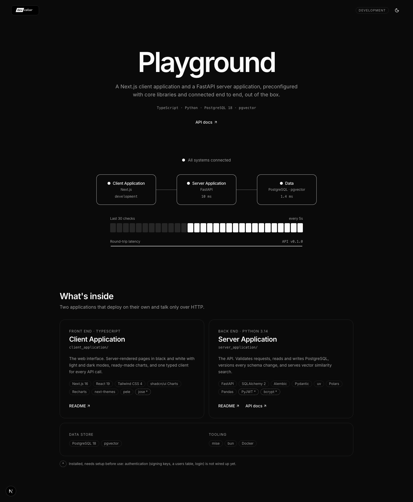
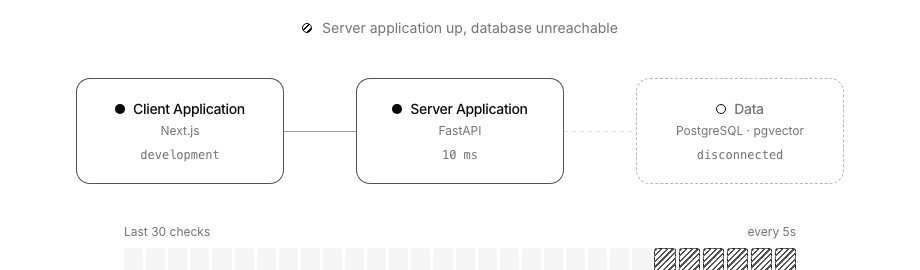
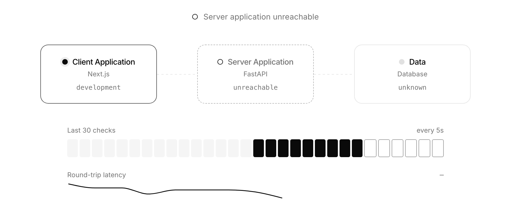
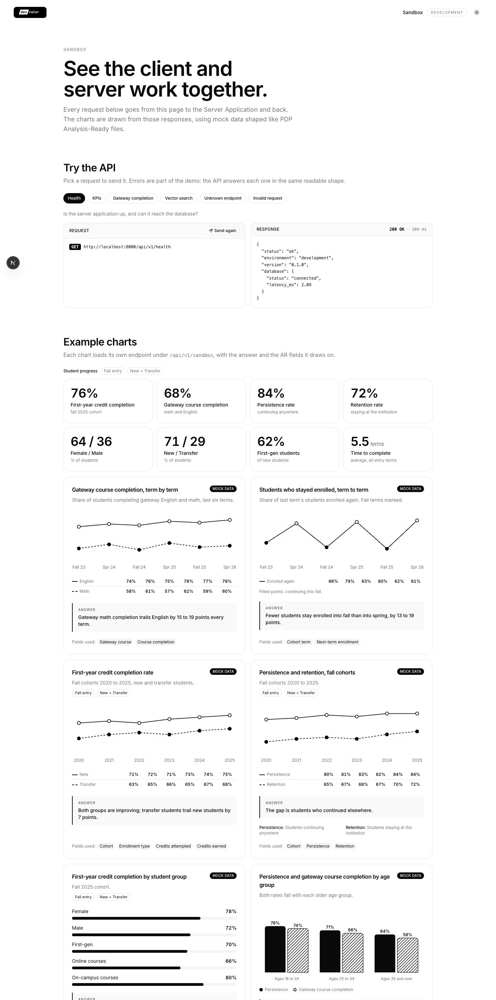
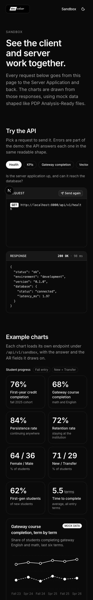
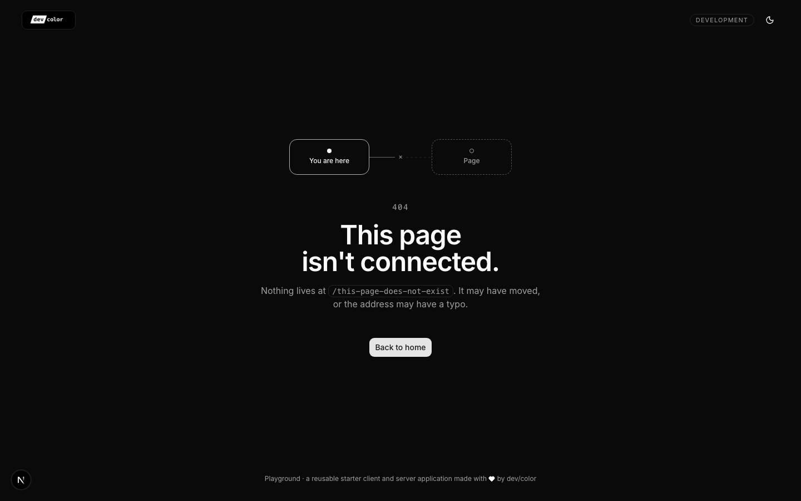

# Client Application

The Next.js front end for Playground; it gets all of its data from the
[Server Application](../server_application/README.md) and deploys on its own.

## Layout

```
src/
├── app/            # Pages: layout.tsx, page.tsx, sandbox/, not-found.tsx, error.tsx, globals.css
├── components/     # Render only. Shared: site header/footer, external link, section heading, load error
│   ├── landing/    # Live status, system diagram, tracker, sparkline, stack cards
│   ├── sandbox/    # API explorer, chart card, trend / bar / grouped-bar charts, KPI grid
│   └── ui/         # shadcn/ui components (button, card, chart, skeleton)
├── content/        # Words and settings shown on pages
│   ├── brand.ts            # Name, tagline, logo, footer credit
│   ├── stack.ts            # "What's inside" cards
│   ├── sandbox-charts.ts   # Which fields each example chart draws, and their labels
│   └── sandbox-requests.ts # The API explorer's preset requests
├── hooks/          # Browser state: use-health-monitor, use-api-resource, use-api-explorer
├── lib/            # Logic, with no markup
│   ├── env.ts                # Which environment we're in + its settings
│   ├── api-client.ts         # The single place that calls the API
│   ├── system-status.ts      # Turns health checks into states, diagram boxes, sparkline points
│   ├── connection-styles.ts  # Classes for each state (solid, striped, outlined)
│   ├── charts.ts             # Chart config, formatting (percent, KPI), bar widths
│   ├── api-explorer.ts       # Sends a preset request and describes the result
│   ├── routes.ts, links.ts   # Page addresses and repository links
│   └── errors.ts, timing.ts, theme.ts, utils.ts
└── services/       # One file per API resource: health.ts, sandbox.ts
public/brand/       # Logo files (swap the logo in src/content/brand.ts, or set it to null)
docs/               # Screenshots used in the READMEs
```

**Rule of thumb:** `.tsx` files render. Calling the API, reading the environment, formatting, mapping
data and every other decision lives in `.ts` files in `lib/`, `services/`, `hooks/` and `content/`, so
it can be reused and tested without a page.

## How to run it locally

Start the database and Server Application first ([root README](../README.md#how-to-run-it-locally)), then:

```bash
mise run web:install && mise run web:dev     # http://localhost:3000
```

### Landing page: http://localhost:3000

A live check of the Server Application and database every 5 seconds, in light or dark mode.

<p>
  
  
</p>

### When something is down

The page says which part, and recovers on its own once it answers again.

| Database stopped (`mise run db`) | Server Application stopped (`mise run api:dev`) |
|---|---|
|  |  |

### Sandbox: http://localhost:3000/sandbox

The **sandbox** endpoint series is where you create and test new features and preview how charts and
graphs look in your development environment. It has live API requests and example charts drawn from mock PDP AR data, and
is turned off in production (override with `NEXT_PUBLIC_SANDBOX_ENABLED`).

<p>
  
  
</p>

| Chart | Type | Endpoint |
|---|---|---|
| Student progress | KPI cards (percent, split, terms) | `/sandbox/kpis` |
| Gateway course completion | Two lines, six terms | `/sandbox/gateway-completion` |
| Students who stayed enrolled | One line, fall terms filled | `/sandbox/term-enrollment` |
| First-year credit completion | Two lines, fall cohorts | `/sandbox/credit-completion` |
| Persistence and retention | Two lines + definitions | `/sandbox/persistence-retention` |
| Completion by student group | Horizontal bars | `/sandbox/completion-by-group` |
| Persistence by age group | Grouped bars, solid vs striped | `/sandbox/persistence-by-age` |
| Time to complete | Horizontal bars | `/sandbox/time-to-complete` |

#### Add a sandbox page

Worked example: http://localhost:3000/sandbox/enrollment. Add the endpoint first
([Server Application README](../server_application/README.md#add-a-sandbox-endpoint)).

1. **Loader:** Add types and loaders in `src/services/sandbox-<topic>.ts`.
2. **Labels:** Set each chart's fields in `src/content/sandbox-<topic>-charts.ts`.
3. **Charts:** Build them in `src/components/sandbox/<topic>-charts.tsx` from `ChartCard` and the existing charts.
4. **Page:** Create `src/app/sandbox/<topic>/page.tsx`. The sandbox layout adds the header, footer and production check.
5. **Link:** Add the address to `src/lib/routes.ts`.

Your page opens at `/sandbox/<topic>`, e.g. `/sandbox/enrollment`.

### 404 and error pages

Unknown addresses and unexpected errors get designed pages ([`not-found.tsx`](src/app/not-found.tsx),
[`error.tsx`](src/app/error.tsx)).



## Environments

Next.js only knows development and production, so the app reads its own `NEXT_PUBLIC_APP_ENV`; defaults
live in [`src/lib/env.ts`](src/lib/env.ts) and overrides in a git-ignored `.env.local`
(copy [`.env.example`](.env.example)).

| Command | Environment | API base URL |
|---|---|---|
| `bun run dev` | `development` | `http://localhost:8000/api/v1` |
| `bun run build:staging` | `staging` | placeholder: `https://api.staging.example.com/api/v1` |
| `bun run build` | `production` | placeholder: `https://api.example.com/api/v1` |

## Commands (from the repo root)

| Command | What it does |
|---|---|
| `mise run web:install` | Install dependencies (`bun install`) |
| `mise run web:dev` | Run with hot reload on http://localhost:3000 |
| `mise run web:build` | Production build |
| `mise run web:build-staging` | Staging build |
| `mise run web:start` | Serve the last build |
| `mise run web:lint` | ESLint + TypeScript type check |
| `bunx shadcn@latest add <name>` | Add a shadcn/ui component |

## Libraries Included

Click a layer to see the libraries.

📦 *Available* = installed, not yet used.\
🔐 *Needs setup* = authentication pieces, intentionally not built.

<details open>
<summary><strong>Front End: TypeScript</strong></summary>

- [Next.js](https://nextjs.org/): Server-rendered React framework with route protection via its proxy.
- [Tailwind CSS](https://tailwindcss.com/): Utility-first styling with dark mode.
- [shadcn/ui Charts](https://ui.shadcn.com/charts): Donut, line and bar chart components.
- [Recharts](https://recharts.org/): SVG engine behind shadcn/ui Charts.
- [lucide-react](https://lucide.dev/): Icon set used by shadcn/ui (sun, moon, arrows).
- [next-themes](https://github.com/pacocoursey/next-themes): Light/dark mode that follows the OS, no flash on load.
- [pele](https://pele.run): 📦 Renders Mermaid diagrams as themed SVG.
- [jose](https://github.com/panva/jose): 📦 🔐 Verifies login tokens in the proxy; needs the API's signing key
  and a `proxy.ts`.

</details>

<details>
<summary><strong>Tooling</strong></summary>

- [bun](https://bun.sh): JavaScript runtime and package manager.
- [mise](https://mise.jdx.dev): Installs and pins versions of almost any language or tool (e.g., Node,
  Python, Rust, Ruby, Go, Java and more). Here it pins bun and Node, and runs the `web:*` commands
  (see 👉🏾 [Commands](#commands-from-the-repo-root)).

</details>
