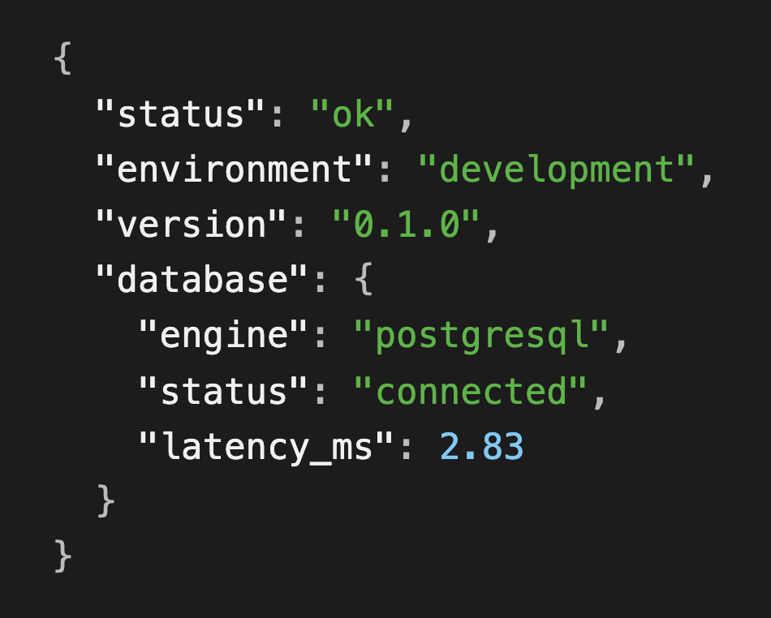
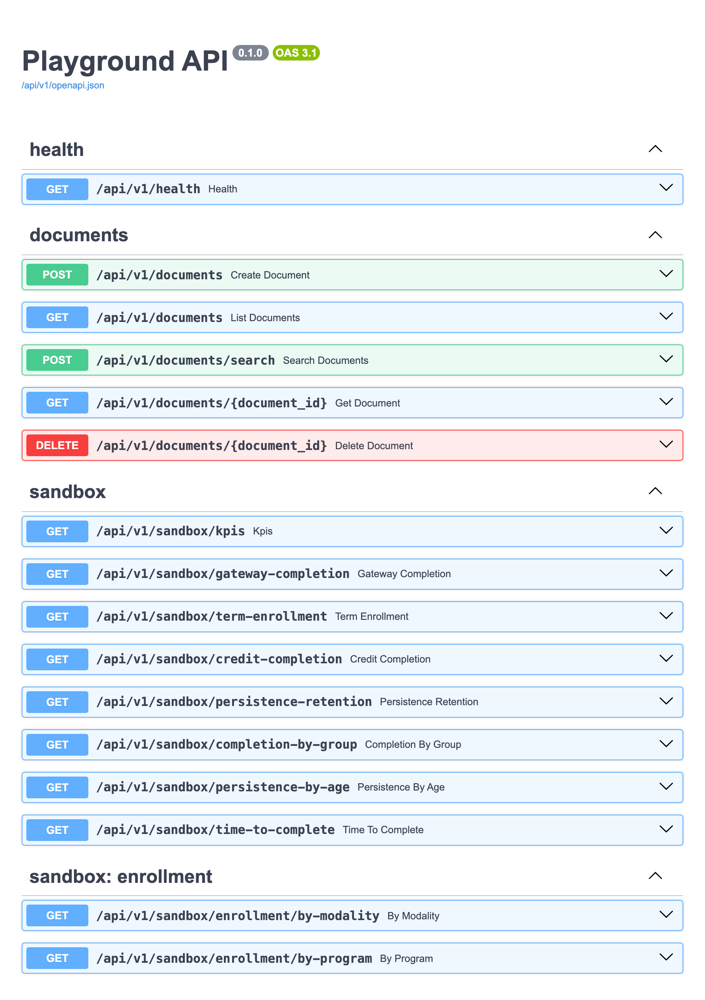
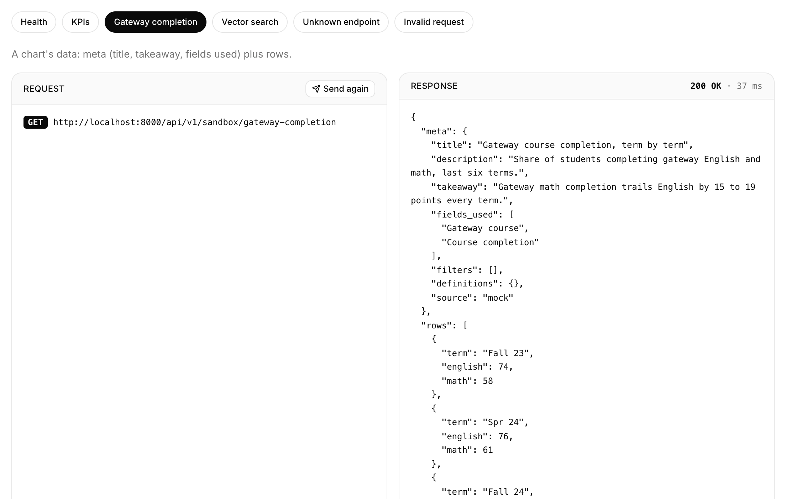

# Server Application

The FastAPI back end for Playground; it serves the [Client Application](../client_application/README.md)
and deploys on its own with just this folder and a `DATABASE_URL`.

## Layout

```
app/
├── main.py               # create_app(): middleware, routers, lifespan
├── core/config.py        # Settings, resolved from APP_ENV
├── core/errors.py        # One JSON shape for every error
├── db/base.py            # Base (naming convention), UUIDv7 + timestamp mixins
├── db/session.py         # Async engine, get_session dependency
├── models/               # SQLAlchemy models (import each in models/__init__.py)
├── schemas/              # Pydantic request/response models
├── services/             # Business logic; routes stay thin
├── api/dependencies.py   # SessionDep, EmbedderDep: shared by every route module
└── api/v1/routes/        # HTTP endpoints
alembic/                  # Migrations (config in pyproject.toml [tool.alembic])
tests/
```

## Run locally

From the repo root:

```bash
mise run db                                  # start the database first
mise run api:install && mise run api:dev     # http://localhost:8000
```

Health check: http://localhost:8000/api/v1/health



Every endpoint, ready to try: http://localhost:8000/docs



### Database migrations

`api:dev` applies pending migrations first, in local development only; staging and production migrate
as a deploy step. To skip them once:

```bash
AUTO_MIGRATE=false mise run api:dev
```

To skip them always, add this to a git-ignored `mise.local.toml` at the repo root:

```toml
[env]
AUTO_MIGRATE = "false"
```

## Environments

`APP_ENV` picks `development` (default), `staging` or `production`; settings then load from
`.env.<APP_ENV>` (committed defaults), `.env.<APP_ENV>.local` (git-ignored secrets) and real environment
variables, which always win. `postgres://` URLs from hosts are converted to the async driver.

## Commands (from the repo root)

| Command | What it does |
|---|---|
| `mise run api:install` | Install dependencies (`uv sync`) |
| `mise run api:dev` | Apply pending migrations, then run with reload on http://localhost:8000 |
| `mise run api:test` | Run tests |
| `mise run api:lint` / `api:format` | Ruff lint / auto-fix + format |
| `mise run api:migrate` | Apply migrations |
| `mise run api:migrate-down` | Roll back one migration |
| `mise run api:migration "..."` | Autogenerate a migration from model changes |

## Endpoints

All under `/api/v1`; try them at http://localhost:8000/docs.

| Method | Path | What it does |
|---|---|---|
| `GET` | `/health` | Environment, version, database status (`503` if the database is down) |
| `POST` | `/documents` | Store text and its vector embedding |
| `GET` | `/documents` | List documents, newest first (`limit`, `offset`) |
| `GET` | `/documents/{id}` | Fetch one document |
| `DELETE` | `/documents/{id}` | Delete a document |
| `POST` | `/documents/search` | Most similar documents to a query, via pgvector cosine distance |
| `GET` | `/sandbox/kpis` | Headline measures, including splits like Female / Male 64 / 36 |
| `GET` | `/sandbox/gateway-completion` | Gateway English vs math, last six terms |
| `GET` | `/sandbox/term-enrollment` | Term-to-term enrollment, last six terms |
| `GET` | `/sandbox/credit-completion` | First-year credit completion, new vs transfer, fall cohorts 2020 to 2025 |
| `GET` | `/sandbox/persistence-retention` | Persistence vs retention, fall cohorts, with definitions |
| `GET` | `/sandbox/completion-by-group` | First-year credit completion per student group |
| `GET` | `/sandbox/persistence-by-age` | Persistence and gateway completion per age group |
| `GET` | `/sandbox/time-to-complete` | Average terms to completion per entry term |

### Errors

Every error has the same JSON shape ([`core/errors.py`](app/core/errors.py)):

```json
{"error": {"status": 404, "code": "not_found", "message": "No endpoint matches GET /api/v1/nope.",
           "path": "/api/v1/nope", "docs": "/docs"}}
```

| Situation | Status | `code` |
|---|---|---|
| Unknown endpoint (points to `/docs` outside production) | 404 | `not_found` |
| Missing resource, e.g. a deleted document | 404 | `not_found` |
| Wrong HTTP method | 405 | `method_not_allowed` |
| Invalid request body or query (lists each field in `details`) | 422 | `validation_error` |
| Unexpected server error (details stay in the server log) | 500 | `internal_error` |

### Sandbox

Mock data shaped like PDP Analysis-Ready files, answering with `meta` (title, takeaway, fields used) and
`rows`; off in production via `SANDBOX_ENABLED`. Code: [route](app/api/v1/routes/sandbox.py) ·
[schemas](app/schemas/sandbox.py) · [data](app/services/sandbox.py).

```bash
curl http://localhost:8000/api/v1/sandbox/gateway-completion
```

```json
{
  "meta": {
    "title": "Gateway course completion, term by term",
    "description": "Share of students completing gateway English and math, last six terms.",
    "takeaway": "Gateway math completion trails English by 15 to 19 points every term.",
    "fields_used": ["Gateway course", "Course completion"],
    "filters": [],
    "definitions": {},
    "source": "mock"
  },
  "rows": [
    { "term": "Fall 23", "english": 74.0, "math": 58.0 },
    { "term": "Spr 24", "english": 76.0, "math": 61.0 }
  ]
}
```



## Libraries Included

Items marked *available* are installed and ready to import but not yet wired into a feature. Items marked *needs setup* (jose, PyJWT, bcrypt) also need configuration first: authentication (signing keys, a users table, login) is intentionally not built yet.

### Back End: Python

- [FastAPI](https://fastapi.tiangolo.com/): A high-performance Python web framework used for API routing, background PDP file upload processing, and query translation.
- [uv](https://github.com/astral-sh/uv): An extremely fast Python package installer and dependency resolver written in Rust that speeds up project setup and builds.
- [SQLAlchemy 2.1.5](https://www.sqlalchemy.org/): Typed, async ORM used to define database models and run queries from FastAPI.
- [Alembic](https://alembic.sqlalchemy.org/): Database migration tool for SQLAlchemy that records every schema change as a versioned script, so every environment's database can be upgraded or rolled back the same way.
- [Pydantic](https://docs.pydantic.dev/): Validates incoming request data and serializes responses to JSON; FastAPI is built on it.
- [PyJWT](https://pyjwt.readthedocs.io/): *Available, needs setup:* issuing tokens needs a signing key in settings and login endpoints. Issues and verifies signed JWT tokens containing user roles (`import jwt`).
- [bcrypt](https://github.com/pyca/bcrypt): *Available, needs setup:* needs a users table and sign-up/login endpoints to hash and check passwords. Hashes passwords with a deliberately slow, salted algorithm so stored passwords can't be reversed or cheaply guessed (`bcrypt.hashpw` / `bcrypt.checkpw`).

### Data Processing

- [Pandas](https://pandas.pydata.org/) / [Polars](https://pola.rs/): *Available.* High-speed Python data processing libraries used to parse, clean, and aggregate multi-column PDP AR files in seconds. Polars does the heavy lifting; Pandas covers libraries that expect it; [pyarrow](https://arrow.apache.org/docs/python/) converts between them (`df.to_pandas()`, `pl.from_pandas(df)`).

### Data Store

- [PostgreSQL 18](https://www.postgresql.org/): An enterprise-grade open-source relational database used for secure storage of student records using standard tables and binary JSONB fields.
- [pgvector](https://github.com/pgvector/pgvector): Postgres extension that stores embeddings as vector columns and finds the most similar rows with fast, indexed similarity search.

## Conventions

- **Alembic owns the schema.** The app never calls `create_all`. Review every autogenerated
  migration, then check that it applies, rolls back and applies again:

  ```bash
  mise run api:migrate && mise run api:migrate-down && mise run api:migrate
  ```
- **IDs are UUIDv7:** `uuid.uuid7()` in Python, `uuidv7()` in Postgres. Use `UUIDPrimaryKeyMixin`.
- **Serialization is Pydantic v2:** return schema objects from routes; no custom JSON response class.
- **Embeddings:** `HashingEmbedder` ([`services/embeddings.py`](app/services/embeddings.py)) needs no
  model or key and matches shared words; implement `Embedder` with a real model for semantic search.
- **Tests** use their own `playground_test` database, created and migrated automatically.
